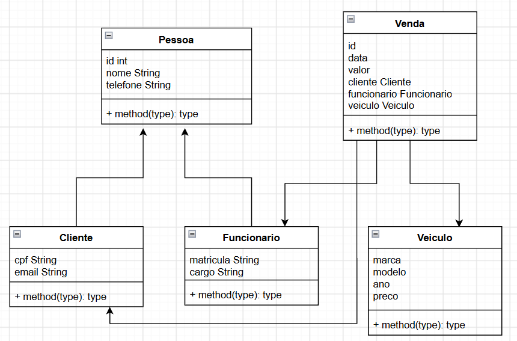

# Sistema-Concessionaria---POO

O AutoCar é um sistema de gerenciamento de concessionária desenvolvido em Java, com o objetivo de facilitar o controle de clientes, funcionários, veículos e vendas.

---

## Modelagem Inicial

Este diagrama foi utilizado como o ponto de partida básico do projeto para exemplificar e planejar a estrutura inicial das classes e arquivos que iríamos implementar:

<p align="center">
  
</p>


---

## Decisões de modelagem e implementação

* **A classe `Pessoa`** foi definida como abstrata por representar características compartilhadas entre clientes e funcionários, evitando a repetição de atributos e métodos.
* **A interface `Identificavel`** estabelece um contrato comum para diferentes entidades, permitindo que cada classe implemente sua própria descrição. Essa estrutura também demonstra o uso do polimorfismo.
* **A interface genérica `Crud`** define as operações básicas de gerenciamento de dados, sendo implementada pelas classes responsáveis por cada entidade.
* **A classe `Venda`** representa a associação entre cliente, funcionário e veículo. Dessa forma, os relacionamentos são representados por objetos na aplicação e por chaves estrangeiras no banco de dados.
* **As operações de acesso ao banco** foram separadas das classes de entidades, mantendo a responsabilidade de cada parte do sistema mais organizada.

---

## Instalação e execução

1. Clonar o repositório.
2. Criar o banco de dados.
3. Abrir o MySQL Workbench e executar o script `banco.sql`, localizado no projeto. O script cria o banco `autocar_java` e suas respectivas tabelas.
4. Abra o arquivo `Conexao.java`, substituindo o usuário (se necessário) e a senha do MySQL local:
   ```java
   private static final String USUARIO = "root";
   private static final String SENHA = "sua_senha"; 